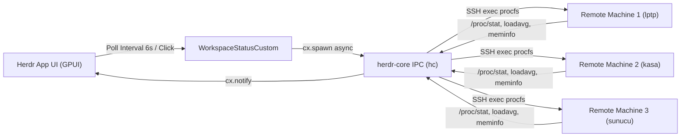

# Herdr Machines Monitor (`herdr-machines-monitor`)

[](LICENSE)
[](https://herdr.dev)
[](https://herdr.dev)
[](https://gpui-kit.com)

**Herdr Machines Monitor** is an ultra-lightweight, native GPUI extension for [Herdr App](https://herdr.dev) that brings live, non-intrusive CPU and RAM utilization metrics for your connected remote machines (`hc machine ls`) directly into Herdr's bottom status bar.


---

## Why "Machines"?

In Herdr's architecture, connected remote hosts, VPS instances, laptops, and home servers are officially called **Machines** (managed via `hc machine add`, `hc machine ls`, and the native `machines()` API). This extension follows Herdr's core design philosophy by providing a clean, cohesive, and native monitoring experience without external bloat.

---

## Key Features

- **⚡ Zero Background Overhead (0 MB Idle RAM):**
  Does not run any standing background daemons, cron jobs, or heavy Node.js runtimes. Metrics are fetched asynchronously through `herdr-core` IPC directly from Linux kernel procfs (`/proc/stat`, `/proc/loadavg`, `/proc/meminfo`).

- **🎯 Ultra-Clean, Compact UI:**
  No redundant server icons or cluttered widgets wasting precious status bar space. Blends seamlessly into Herdr's native dark chrome styling.

- **🔄 On-Demand Refresh with Native Animated Spinner:**
  Clicking any machine directly in the status bar triggers an instant metric refresh. While polling, a native GPU-accelerated spinner (`.spin(900)`) animates beside the machine's name in Rust at 30 fps, disappearing automatically the moment fresh data arrives.

- **🚦 Real-Time Health Status Indicators:**
  - **🟢 Normal:** Machine is healthy and responsive.
  - **🟡 Warning:** CPU usage > 65% or RAM usage > 80%.
  - **🔴 Critical:** CPU usage > 85% or RAM usage > 90%.
  - **⚪ Offline:** Host is unreachable or disconnected; clicking retries connection.

- **📊 Rich Hover Tooltips:**
  Hover over any machine to inspect granular telemetry:
  - Exact memory usage: `RAM X.X / Y GB (Z%)`
  - Linux 1-minute load average: `load X.XX`
  - True kernel delta CPU tick percentage.

- **🛡️ Host Concurrency & Fault Tolerance:**
  Each machine is polled concurrently and independently with a strict **3.5-second timeout**. If a remote VPS or laptop experiences network jitter or goes to sleep, the UI and other machines remain completely smooth and unaffected.

- **✨ Automatic Discovery:**
  Dynamically tracks machines added via `hc machine add` or Herdr App's sidebar without requiring window restarts.

---

## Installation

Run the one-line installer:

```bash
git clone https://github.com/fitzgpt/herdr-machines-monitor.git
cd herdr-machines-monitor
./install.sh
```

The script copies the mod into `~/.config/herdr-app/mods/workspace-status-custom/`, verifies it with `herdr-app check`, and switches Herdr to the custom layout with live reload enabled.

---

## Uninstallation

To restore Herdr App's default layout and remove the extension:

```bash
cd herdr-machines-monitor
./uninstall.sh
```

---

## Architecture



### CPU Calculation Math
Unlike naive tools that use instantaneous load averages as a proxy for CPU, `herdr-machines-monitor` tracks actual kernel jiffies from `/proc/stat`:

$$\Delta_{\text{total}} = \text{total\_time}_2 - \text{total\_time}_1$$
$$\Delta_{\text{busy}} = \text{busy\_time}_2 - \text{busy\_time}_1$$
$$\text{CPU \%} = \min\left(100, \max\left(0, \frac{100 \times \Delta_{\text{busy}}}{\Delta_{\text{total}}}\right)\right)$$

On the first sample, an automatic 600ms follow-up tick is scheduled to compute accurate delta usage immediately.

---

## Compatibility

- **Herdr App:** v0.1.10 or newer
- **herdr-core (`hc`):** v0.1.15 or newer
- **OS:** Linux (Arch, Ubuntu, Debian, Fedora, CachyOS, etc.) / macOS
- **Remote Hosts:** Any Linux machine reachable via SSH with procfs support.

---

## License

Distributed under the [MIT License](LICENSE).
Created with ❤️ for the Herdr community.
