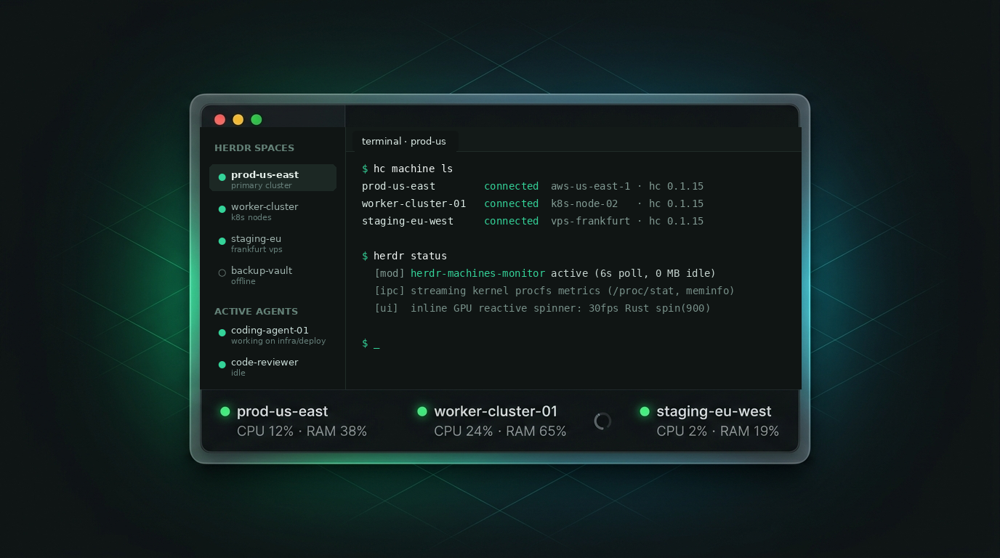

# Machines Monitor

A native GPUI status bar extension for Herdr App that displays live, non-intrusive CPU and RAM utilization metrics for all connected remote machines (`hc machine ls`) directly in the bottom bar, with on-demand click refresh and a native GPU-accelerated spinner.

## What you see

A 29px tall bottom status bar on `theme().chrome`, with a 1px top border in `theme().border`, padding `px(14)`, and typography at 11.8px in `theme().muted`. Left to right:

1. **Active space indicator:** a monitor/server icon in `theme().muted` with the current machine name ("This computer" or remote space), and active git branch chip if applicable.
2. **Agents counter:** a 6px circular dot in `theme().dim` followed by "N agents", plus an alert chip (`· N needs you` in `theme().blocked`) when agents are blocked.
3. **Separator:** a 12px tall, 1px wide vertical rule in `theme().border`.
4. **Machines section:** a horizontal flex container with 8px gap listing each connected remote machine (`machines()`):
   - A 6px rounded status dot indicating node health:
     - Normal: `theme().done` (green) or `theme().accent`.
     - Warning (>65% CPU or >80% RAM): `theme().working` (yellow).
     - Critical (>85% CPU or >90% RAM): `theme().blocked` (red).
     - Offline: `theme().dim` (gray).
   - Machine display name in `theme().foreground`.
   - When polling: an inline 11px animated SVG spinner (`mods/workspace-status-custom/spinner.svg`) rotating at 900ms (`.spin(900)`) in `theme().working` or `theme().accent`.
   - Telemetry (online): `CPU XX%` in muted/working/blocked, a middle dot `·` in dim, and `RAM YY%` in muted/working/blocked.
   - Telemetry (offline): `offline` in `theme().dim`.
5. **Spacer:** a `div().flex_1()` that pushes the command palette hint to the far right.
6. **Palette button:** "Ctrl Shift P commands" in `theme().dim`, clickable to invoke `app.palette`.

---

## How it behaves

- **Automatic Polling:** Every 6000ms (`cx.timer.every(6000)`), the mod polls all remote machines concurrently.
- **On-Demand Click Refresh:** Clicking any machine pill in the status bar triggers an immediate fetch for that machine. If the machine was offline, it first re-queries `hc machine ls` to verify connection state.
- **Reactive Inline Spinner:** Polling sets `this.pollingMachine[name] = true; cx.notify();`, immediately drawing the animated spinner beside the machine name. Once `/proc` data arrives (or upon timeout), `this.pollingMachine[name] = false; cx.notify();` unmounts the spinner.
- **Rich Hover Tooltips:** Hovering over any machine displays an exact summary: `<name>: CPU X% (load Y.YY) · RAM A.A/B GB (C%) — Tıkla: Yenile`.
- **Fault-Tolerant Timeouts:** Each host is queried with a strict 3500ms timeout (`execWithTimeout`). Unresponsive, sleeping, or high-latency machines never freeze the UI or delay other nodes.
- **Lifecycle Cleanup:** In `close()`, `this.mainTimer` and all background `activeTimers` are safely cancelled.

---

## Built from

- **Mod folder:** `mods/workspace-status-custom/`
  - `main.js`: Extends `View`, implements `init(props, cx)`, `pollMachine(m, cx)`, `render(cx)`, and `close(cx)`.
  - `mod.json`: Declares mod identity and metadata.
  - `spinner.svg`: 24x24 vector arc icon for native `.spin()` rotation.
- **Layout:** `layouts/main-custom.json`: Clones the default `main` layout, replacing `workspace-status` with `workspace-status-custom`.
- **Herdr APIs:**
  - `machines()`: Returns registered machines.
  - `hc(["machine", "ls", "--json"])`: Queries live remote connection states.
  - `exec("sh", ["-c", "..."], { on: machineName })`: Runs lightweight procfs inspection on target machine over herdr-core IPC.
  - `theme()`: Accesses dynamic UI palette (`chrome`, `border`, `foreground`, `muted`, `dim`, `accent`, `working`, `blocked`, `done`).
  - `spaces()`, `agents()`, `run("app.palette")`.

---

## Watch out

- Never use instantaneous 1m load average as CPU percentage; on multi-core systems (e.g. 16 threads), a load of 2.0 is only ~12% utilization. Always compute delta busy vs total ticks from `/proc/stat`.
- On first sample, delta CPU cannot be computed yet; schedule a fast 600ms follow-up poll to populate honest CPU percentage immediately.
- Ensure `cx.notify()` is called both before and inside `finally` during `pollMachine` so the spinner visibly renders and reliably disappears.
- Remote procfs execution must be strictly wrapped with timeout timers; otherwise, a network drop leaves unfulfilled promises in memory.

---

## Done when

- `herdr-app check mods/workspace-status-custom` passes with exit code 0.
- All remote machines configured in `hc machine ls` appear in the status bar with color-coded health dots.
- Clicking any machine triggers the inline spinner beside its name, resolving within 100-300ms with updated CPU and RAM values.
- Taking down a remote machine gracefully marks it as `offline` without crashing the status bar.
